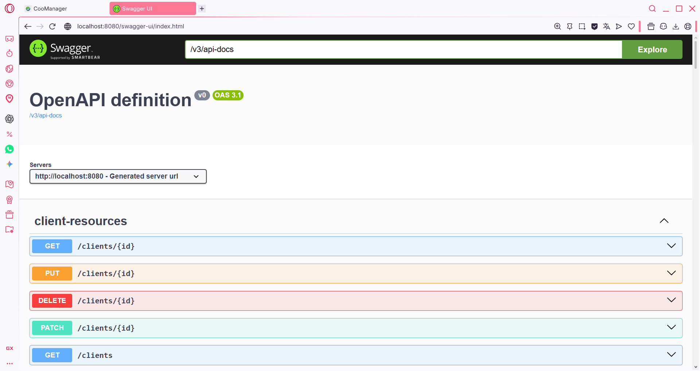
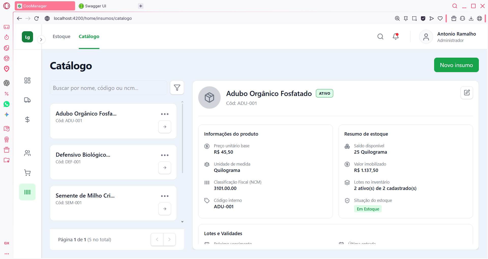
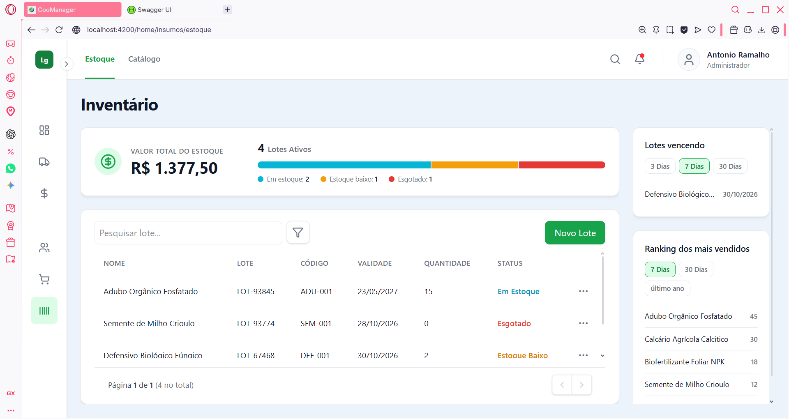
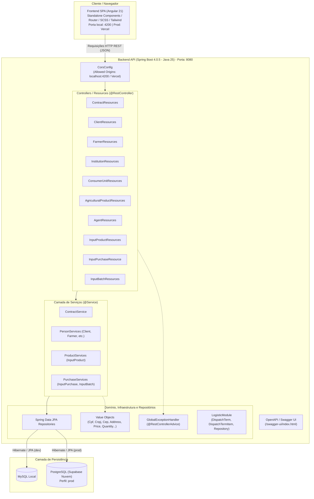

# CooManager – Sistema de Gestão para Pequenas Cooperativas

Sistema que ajuda cooperativas de agricultura familiar a gerenciar editais públicos, agricultores e entregas, validando automaticamente as regras de cada edital.

**Demo:** [Frontend (Vercel)](https://coo-manager-two.vercel.app) | [API (Render)](https://coo-manager.onrender.com)

> Projeto pessoal e não comercial, criado para estudar programação orientada a objetos, arquitetura de software e desenvolvimento de APIs a partir de problemas reais do meu trabalho. Todos os dados são fictícios.
>
> Nota: a API roda no plano gratuito do Render, que desliga a aplicação quando ela fica sem uso. A primeira requisição pode demorar alguns minutos; depois disso, o sistema responde normalmente. A aplicação não possui autenticação; os dados são fictícios e qualquer pessoa pode alterá-los.

*English summary: a full stack system (Spring Boot + Angular) that helps small family-farming cooperatives manage public procurement notices, farmers and deliveries, automatically validating each notice's business rules. Personal learning project, fictional data.*

## Telas







## O problema

Pequenas cooperativas de agricultura familiar enfrentam desafios sérios de gestão, e um bom exemplo é o controle de editais públicos. Para participar de um edital, a cooperativa precisa seguir uma série de regras e manter um controle rigoroso das entregas. Por exemplo: no edital X, apenas agricultores que produzem produtos orgânicos podem entregar, e cada agricultor pode entregar até Y quilos de determinado produto e até Z reais em valor financeiro naquele edital.

Controlar tudo isso manualmente é difícil e propenso a erros. É aí que entra o CooManager.

## Funcionalidades

**Regras de negócio validadas pelo sistema (v1.0)**
- Só permite entregas de agricultores que atendem às exigências do edital (por exemplo, produção orgânica, com certificado).
- Controla o limite de quantidade (quilos) e de valor (R$) que cada agricultor pode entregar em cada edital.
- Validação dos dados inseridos no cadastro do cliente.
- Impede cadastrar um lote que já existe.
- Impede vendas de produtos que não foram adquiridos ou com validade vencida.
- Impede cadastro de lotes sem um insumo cadastrado.

**Cadastros e gestão**
- **Editais:** cadastro e acompanhamento dos editais públicos e de suas regras.
- **Agricultores e clientes:** cadastro com validação de dados (CPF, CNPJ, CEP e endereço).
- **Produtos:** cadastro de produtos agrícolas e de insumos.
- **Compras e lotes:** registro de compras de insumos e controle dos lotes.
- **Logística:** geração de termos de expedição das entregas.

## Arquitetura



O back-end segue uma **arquitetura em camadas** (Resources, Services, Repositories e Domain), com domínio rico e organização por contexto de negócio. A API é totalmente desacoplada do front-end, que consome os dados por HTTP/REST. No código, os editais são representados pela entidade Contract.

## Tecnologias

| Camada | Tecnologias |
|---|---|
| Back-end | Java 25, Spring Boot 4.0.5, Spring Data JPA e Hibernate |
| Front-end | Angular 21 (standalone components, componentes dumb e smart), TypeScript, TailwindCSS, SCSS |
| Banco de dados | MySQL (desenvolvimento) e PostgreSQL no Supabase (produção) |
| Testes | JUnit 5 |
| Documentação da API | Swagger / OpenAPI e coleção do Postman |
| Hospedagem | Render (API) e Vercel (front-end) |

## Engenharia de software

- **Domínio rico (DDD):** uso de Value Objects e Entities para centralizar e proteger as regras de negócio.
- **Fail-fast:** validação rigorosa dos dados logo na entrada, evitando processar informações inválidas.
- **Qualidade de código:** aplicação de princípios SOLID e de Object Calisthenics para manter o código limpo, coeso e de fácil manutenção.
- **Testes unitários:** testes automatizados com JUnit 5 para validar as regras de estoque, insumos e lotes.

## Como rodar localmente

**Pré-requisitos:** Java JDK 25, Maven, Node.js com npm e MySQL instalados e configurados.

1. Clone o repositório e entre na pasta do projeto.
2. No MySQL, crie um banco de dados vazio: `CREATE DATABASE coopafi_db;`
3. No back-end, copie `src/main/resources/application-dev.properties.example` para `application-dev.properties` e preencha com os dados do seu banco local (URL, usuário e senha).
4. Suba a API com o perfil de desenvolvimento:
   ```bash
   cd backend
   mvn spring-boot:run -Dspring-boot.run.profiles=dev
   ```
   A API fica em http://localhost:8080 e o Swagger em http://localhost:8080/swagger-ui/index.html
5. Em outro terminal, suba o front-end:
   ```bash
   cd frontend
   npm install
   npm start
   ```
   O front fica em http://localhost:4200

## Testes

```bash
cd backend
mvn test
```

Os testes unitários cobrem as regras de negócio no que tange gestão de estoque, cadastro de insumos e de lotes. No momento as demais regras de negócio não foram validadas via testes unitários, foram testadas manualmente apenas via Postman, pretendo cobri-las com testes automatizados futuramente.

## Documentação da API

- **Swagger (local):** http://localhost:8080/swagger-ui/index.html
- **Coleção do Postman:** [`documentacao/postman_colecao.json`](documentacao/postman_colecao.json). Para usar, importe o arquivo no Postman e ajuste a variável de URL base para a API local ou de produção.

## Infraestrutura e deploy

- **API (produção):** [Render](https://coo-manager.onrender.com), com a senha do banco e demais segredos configurados como variáveis de ambiente.
- **Banco de produção:** PostgreSQL hospedado no Supabase.
- **Front-end (produção):** [Vercel](https://coo-manager-two.vercel.app), configurado para usar a API em produção.
- **No desenvolvimento**: o perfil `dev` usa MySQL local; o perfil `prod` usa o banco em nuvem.

## O que aprendi e próximos passos

Este projeto me ensinou muito em três frentes: modelagem, desenvolvimento full stack e engenharia de software. Aprendi o tempo todo: houve vários momentos em que implementei algo, descobri uma forma melhor de fazer e refatorei.

**Modelagem na prática.** Comecei desenhando o diagrama de classes no Astah. Quando fui implementar, percebi que o desenho não se sustentava e recomecei do zero. Foi assim que entendi, de verdade, relacionamentos entre classes, orientação a objetos e como o diagrama se conecta ao código.

**De zero a uma aplicação publicada.** Antes deste projeto, eu não tinha noção de APIs REST, front-end, banco de dados e deploy. Hoje entendo o básico de cada uma dessas áreas e construí e publiquei uma aplicação funcional, com testes automatizados em parte das regras e documentação da API.

**Próximos passos.** Pretendo me aprofundar em testes e em segurança e autenticação, temas que já estudei, mas ainda não dominei o suficiente.

## Por que este projeto

Meu objetivo era aprender conceitos de programação orientada a objetos, treinar as práticas de Object Calisthenics, estudar arquitetura de software e desenvolvimento de APIs. Decidi usar problemas que encontrei no meu trabalho como um projeto prático onde eu pudesse estudar todos esses conceitos. Este é um projeto pessoal e não comercial; o repositório é público justamente para registrar meu progresso, e todos os dados são fictícios.

## Autor

**Antonio Ramalho** – estudante de Engenharia de Software (PUCPR)
[LinkedIn](https://www.linkedin.com/in/antonio-software) | antonio.ramalho0625@gmail.com
