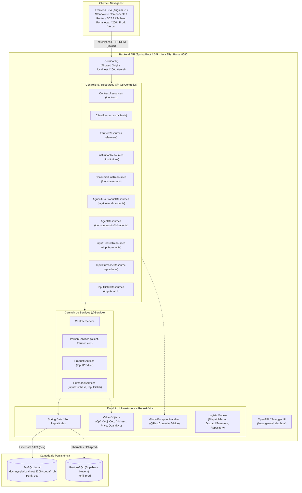

# Motivação para esse repositório

Meu objetivo era aprender conceitos de programação orientada a objetos, treinar e aprender as práticas do Object Calisthenics, estudar mais sobre arquitetura de software e desenvolvimento de API'S. Então decidi usar os problemas que eu encontrei no meu trabalho como um projeto prático aonde eu poderia aprender e estudar todos esses conceitos. Esse é um projeto pessoal e não é comercial, então esse repositório é público justamente para eu registrar meu progresso.

# Sistema de gerenciamento de pequenas cooperativas

Pequenas cooperativas de agricultura familiar sofrem com problemas sérios, um bom exemplo disso é o processo de gestão de editais. Para essas cooperativas participarem de editais publicos elas precisam seguir uma série de regras, além de manter um controle rigoroso de entregas, por exemplo, para edital X apenas agricultores que produzem produtos orgânicos podem entregar, e cada agricultor pode entregar até Y quilos de determinado produto e até Z em valores financeiros de entregas para aquele edital. Todas essas complexidades são dificeis de gerenciar manualmente, e é exatamente aí que entra o sistema de gerenciamento de pequenas cooperativas.

## Funcionalidades

- Gestão de editais: Gerenciamento de editais públicos.
- Gestão de clientes: Gerenciamento de clientes.
- Gestão de agricultores: Gerenciamento de agricultores.
- Gestão de produtos: Gerenciamento de produtos.
- Gestão de compras: Gerenciamento de compras.
- Gestão de lotes: Gerenciamento de lotes.

## Backend

- Linguagem: Java 25
- Framework: Spring Boot 4.0.5
- Banco de dados: MySQL
- ORM: Spring Data JPA e Hibernate
- Arquitetura: Camadas bem definidas (Resources, Services, Repositories, Domain)
- Testes: JUnit 5

## Frontend

- Framework: Angular 21 
- Arquitetura: Baseada em stand Alone Components
- Linguagens: TypeScript
- Estilização: TailwindCSS, SCSS

## Infraestrutura & Plataformas Externas 

- Banco de dados local: MySQL
- Banco de dados em produção: PostgreSQL hospedado no Supabase
- Hospedagem da API (Prod): Render(https://coo-manager.onrender.com) 
- Devido a limitações do plano gratuito, a API pode demorar alguns minutos para responder à primeira requisição, pois o serviço "desliga" a aplicação quando não está em uso.
- Hospedagem do Frontend (Prod): Vercel(https://coo-manager-two.vercel.app) 
- O frontend está configurado para usar o backend em produção.

## Diagrama Arquitetural

## Estrutura do projeto

coopafi/
├── AGENTS.md                                # Regras e diretrizes operacionais do projeto
├── README.md                                # Documentação principal
├── backend/                                 # API desenvolvida em Spring Boot
│   ├── Dockerfile                           # Build de contêiner multi-stage (Java 25)
│   ├── mvnw / mvnw.cmd                      # Maven Wrapper (Linux / Windows)
│   ├── pom.xml                              # Dependências e plugins Maven
│   └── src/
│       ├── main/
│       │   ├── java/com/manager/coopafi/
│       │   │   ├── CoopafiApplication.java  # Classe de inicialização Spring Boot
│       │   │   ├── baseModule/              # Entidades base de recebimento/itens
│       │   │   ├── contractModule/          # Gestão de contratos (DTOs, Entities, Repositories, Resources, Services)
│       │   │   ├── infrastructure/          # Configuração CORS, tratamento de exceções e Value Objects
│       │   │   ├── logisticModule/          # Domínio e repositórios de termos de despacho logístico
│       │   │   ├── personModule/            # Produtores, Clientes, Instituições, Unidades Consumidoras, Agentes
│       │   │   ├── produtcModule/           # Insumos e produtos agrícolas (Resources, Services, Entities)
│       │   │   └── purchaseModule/          # Compras e lotes de insumos (Resources, Services, Entities, DTOs)
│       │   └── resources/
│       │       ├── application.properties       # Define o perfil ativo padrão (spring.profiles.active=dev)
│       │       ├── application-dev.properties   # Configuração do MySQL local e CORS para localhost:4200
│       │       └── application-prod.properties  # Configuração Supabase (PostgreSQL) e CORS para Vercel
│       └── test/
│           └── java/com/manager/coopafi/    # Testes automatizados do backend
├── frontend/                                # Single Page Application em Angular 21
│   ├── angular.json                         # Configurações do workspace Angular
│   ├── package.json                         # Dependências e scripts npm
│   ├── tsconfig.json                        # Configuração do compilador TypeScript
│   ├── vercel.json                          # Regras de rewrite de rotas para deploy na Vercel
│   └── src/
│       ├── main.ts                          # Bootstrap da aplicação Angular
│       ├── index.html                       # HTML principal
│       ├── styles.scss                      # Folhas de estilo globais
│       ├── environments/                    # Variáveis de ambiente (dev e prod)
│       └── app/
│           ├── app.routes.ts                # Definição e carregamento lazy das rotas
│           ├── core/                        # Componentes globais, layout, interceptors e serviços base
│           ├── shared/                      # Componentes compartilhados, pipes, validadores e utilitários
│           └── features/                    # Módulos funcionais da aplicação
│               ├── clients/                 # Gestão de clientes
│               ├── dashboard/               # Painel administrativo
│               ├── farmers/                 # Módulo de agricultores
│               ├── financial/               # Módulo financeiro
│               ├── inputs/                  # Gestão de insumos
│               ├── logistics/               # Módulo de logística
│               └── sales/                   # Módulo de vendas
├── documentacao/                            # Diagramas e documentações auxiliares
└── artefatos/                               # Arquivos e insumos complementares

## Engenharia de Software

- DDD (Domain-Driven Design): Construção de um Domínio Rico utilizando Value Objects e Entities para garantir que as regras de negócio estejam centralizadas e protegidas.

- Fail-Fast: Validação rigorosa de estados logo na entrada dos dados, evitando o processamento de informações inválidas.

- Qualidade de Código: Aplicação de princípios SOLID e técnicas de Object Calisthenics para manter o código limpo, coeso e de fácil manutenção.

- Testes Unitários: Implementação de testes automatizados utilizando JUnit 5 e Mockito para validar a precisão dos cálculos e garantir a integridade das regras de negócio em cada componente do sistema.

# Como rodar localmente

- É preciso ter o Java JDK 25 bem como o maven instalado e configurado.
- É preciso ter o Node.js e npm instalado e configurado.
- É preciso ter o mysql instalado e configurado.
- Copie o arquivo application-dev.properties.example e renomeie para application-dev.properties na pasta resources no backend.
- Renomeie as variaveis de acordo com seu Banco local.
- A API: http://localhost:8080
- O Swagger / OpenAPI: http://localhost:8080/swagger-ui/index.html