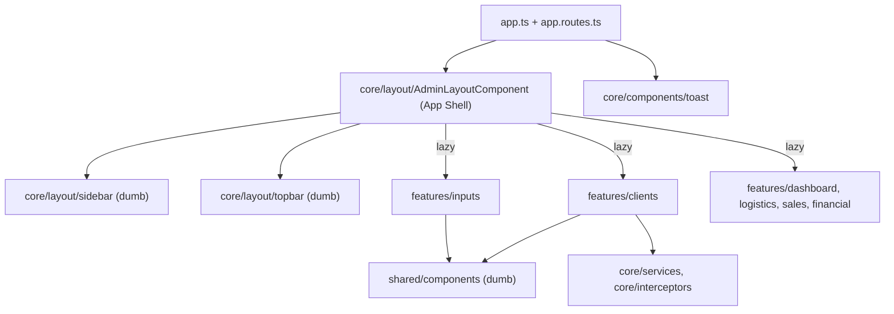
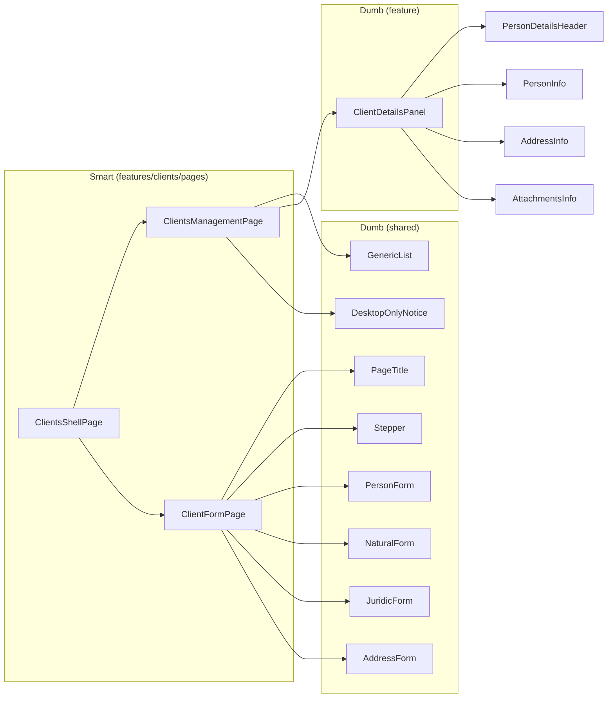

# Plano de Refatoração do Frontend Coopafi (Feature-Driven + Responsividade + Cleanup)

## Objetivo

Migrar o frontend Angular 21 da arquitetura genérica (`core` / `pages` / `shared`) para uma **arquitetura baseada em contexto** (`core` / `features` / `shared`). Também queremos implantar um **App Shell responsivo** e dumb components fluidos (mobile-first), além de limpar a tipagem TypeScript. As URLs e as funcionalidades atuais continuam **100% iguais**.

Decisões já confirmadas por você:

| Tema | Decisão |
|---|---|
| Degradação graciosa | Bloquear **toda a tela de Gestão de Clientes** no mobile (`hidden md:block`) |
| Escopo | Migrar **todas** as páginas para `features/<contexto>` com lazy loading. O `UniversalForm` deixa de existir |
| Código morto | Remover `SearchFilters`, `BrazilianStatesMap` e `openFilters`. Mover CAF/Certificado para `features/farmers` e a API de insumos para `features/inputs` |
| Nomes | Remover o prefixo `I` das interfaces (`Client`, `Address`, `Page<T>`) |

---

## User Review Required

> [!IMPORTANT]
> **Nenhuma dependência nova.** O comportamento responsivo do shell usa o `BreakpointObserver` do `@angular/cdk/layout`, que já está instalado (`@angular/cdk ^21.2.14`). Não mexo em `package.json`.

> [!IMPORTANT]
> **ViaCEP no `AddressFormComponent`.** Hoje ele injeta `HttpClient` direto. Proposta: extrair a chamada para `core/services/zip-code-lookup.service.ts`, um serviço de **infraestrutura** e não de negócio. O formulário passa a injetar só esse serviço tipado, o que preserva o autopreenchimento e o foco no campo "Número".
> *Alternativa mais estrita:* o componente só emite `(zipCodeCompleted)` e o smart component da página faz a busca e o `patchValue`. Isso deixa o form 100% puro, mas cada feature que usar endereço vai repetir essa ligação. **Me diga se prefere a alternativa.**

> [!WARNING]
> **Bloqueio por CSS (`hidden md:block`).** No mobile o componente oculto continua instanciado e **faz as requisições HTTP** (lista de clientes). É o comportamento pedido (Tailwind puro). Se no futuro quiser evitar o tráfego, dá para trocar por `@if (isDesktop())` com o `BreakpointObserver`.

> [!NOTE]
> **Arquivos renomeados e movidos.** Como todos os arquivos mudam de lugar, o diff do Git vai aparecer como delete + add. Mantenho os **seletores** atuais sempre que possível (ex.: `app-person-address-info`). Assim os templates não quebram e a revisão fica mais fácil.

---

## Arquitetura Alvo



### Árvore de pastas proposta

```text
src/app/
├── app.config.ts · app.routes.ts · app.ts · app.html
├── core/                                  # Singleton/global — nunca importa de features/
│   ├── components/toast/                  # (smart) consome ToastService — sai de shared/
│   ├── interceptors/  error.interceptor.ts · auth.interceptor.ts
│   ├── layout/
│   │   ├── admin-layout/                  # (smart) App Shell: breakpoint, drawer, colapso
│   │   ├── sidebar/                       # (dumb) menu data-driven
│   │   ├── topbar/                        # (dumb) hambúrguer + usuário
│   │   └── navigation.config.ts           # NavSection[] (substitui HTML repetido)
│   ├── models/        page.model.ts · toast-message.model.ts · nav-item.model.ts
│   └── services/      toast.service.ts · zip-code-lookup.service.ts
├── features/
│   ├── clients/
│   │   ├── clients.routes.ts
│   │   ├── data/       client-api.service.ts
│   │   ├── models/     client.model.ts · client-details.model.ts
│   │   ├── mappers/    client.mapper.ts             # funções puras (testáveis)
│   │   ├── forms/      client-form.builder.ts · person-type-rules.ts
│   │   ├── components/ client-details-panel/        # (dumb)
│   │   └── pages/      clients-shell/ · clients-management/ · client-form-page/  # (smart)
│   ├── inputs/
│   │   ├── inputs.routes.ts
│   │   ├── data/ input-product-api.service.ts · models/ input-product.model.ts
│   │   └── pages/ inputs-shell/ · input-stock/ · input-catalog/ · input-form-page/
│   ├── farmers/components/ caf-info/ · organic-certificate-info/
│   ├── dashboard/ · logistics/ · sales/ · financial/   # cada um com pages/<nome>-page
└── shared/                                # Só dumb: @Input/@Output, sem serviços de negócio
    ├── components/
    │   ├── ui/          button/
    │   ├── feedback/    desktop-only-notice/            # NOVO
    │   ├── layout/      stepper/ · details-panel/ · sub-nav/ (NOVO) · page-title/ (NOVO)
    │   ├── forms/       input-error/ · address-form/ · person-form/ · natural-person-form/ · juridic-person-form/
    │   ├── data-display/ person-details-header/ · person-info/ · address-info/ · attachments-info/
    │   └── lists/       generic-list/ · generic-card-list/ · pagination/ · search-bar/
    ├── enums/   brazilian-state.ts · gender.ts · status.ts · person-type.ts (NOVO)
    ├── models/  address.model.ts · attachment.model.ts · list-card-item.model.ts
    ├── pipes/   (mesmos 7 pipes, renomeados para *.pipe.ts)
    ├── utils/   document-format.ts            # formatação pura reutilizada pelo pipe e pelo mapper
    └── validators/ custom-validators.ts       # sai de core/ (funções puras de formulário)
```

**Padrão de nomes:** `feature-name.component.ts|html|scss`, `*.service.ts`, `*.model.ts`, `*.pipe.ts` e `*.routes.ts`, seguindo o AGENTS.md. Também removo o `standalone: true`, que é redundante desde o Angular 19.

---

## Proposed Changes

### Fase 0 — Baseline

Rodar `ng build` e `ng test --watch=false` **antes** de qualquer mudança, para registrar o estado atual. Hoje o `app.spec.ts` espera um `<h1>Hello, coopafi-front</h1>`, que não existe, então deve falhar.

---

### Fase 1 — Diretriz 4 (parte 1): Modelos e tipagem unificada

Faço primeiro porque todos os outros passos dependem dos tipos.

#### [NEW] shared/models/address.model.ts
```ts
import { BrazilianStateCode } from '../enums/brazilian-state';

/** Endereço compartilhado entre clientes, cooperados e agricultores. */
export interface Address {
  zipCode: string;
  street: string;
  neighborhood: string;
  city: string;
  state: BrazilianStateCode;   // corrige bug: campo existia no form e no template, mas não na interface
  number: string;
}
```

#### [NEW] shared/enums/person-type.ts
```ts
export enum PersonType {
  NATURAL = 'NATURAL',
  JURIDIC = 'JURIDIC',
}
```

#### [NEW] features/clients/models/client.model.ts (substitui `IClient.ts`)
União discriminada por `personType`. Ela **elimina os casts** `client as INaturalClientDto` espalhados em 2 componentes.
```ts
interface ClientBase {
  id: number;
  legalName: string;
  email: string;
  phone: string;
  status: Status;
  address: Address;
}
export interface NaturalClient extends ClientBase {
  personType: PersonType.NATURAL; cpf: string; birthDate: string; gender: Gender;
}
export interface JuridicClient extends ClientBase {
  personType: PersonType.JURIDIC; cnpj: string; foundationDate: string; tradeName: string;
}
export type Client = NaturalClient | JuridicClient;

export type ClientSummary = Pick<ClientBase, 'id' | 'legalName' | 'status'> & { documentNumber: string };
export type ClientCreate  = Omit<NaturalClient, 'id' | 'status'> | Omit<JuridicClient, 'id' | 'status'>;
export type ClientUpdate  = Omit<NaturalClient, 'id' | 'status' | 'cpf'> | Omit<JuridicClient, 'id' | 'status' | 'cnpj'>;
```

> [!NOTE]
> Hoje o `insert(client: IClient)` exige `id` e `status` no payload, o que não faz sentido em um cadastro. O `ClientCreate` corrige isso. Vou confirmar no backend (`ClientInsertDTO`) quais campos ele espera antes de fechar o tipo.

#### Mapa de unificação de interfaces

| Antes | Depois | Motivo |
|---|---|---|
| `IClientMinDto` | `ClientSummary` | rename + `status: Status` |
| `IClientDto` + `INaturalClientDto` + `IJuridicClientDto` + `IClient` | `ClientBase` (privado) + `NaturalClient` / `JuridicClient` / `Client` | união discriminada, sem casts |
| `IUpdateNaturalClient` + `IUpdateJuridicClient` + `IUpdateClient` | `ClientUpdate` (1 type) | 3 declarações → 1 |
| `ClientDetailsView` (`address: any`, `attachments: any[]`, `tradeName` não usado) | `ClientDetails` tipado (`Address`, `Attachment[]`) | remove `any` e campo morto |
| `IAddressDto` | `Address` (+ `state`) | corrige o campo ausente |
| `IAttachments` | `Attachment` (`id: number`, `size: number`) | singular, sem união `string \| number` |
| `ISimpleListCard` (em core) | `ListCardItem` (em `shared/models`) | é um modelo de UI, não de core |
| `IPage<T>` | `Page<T>` (em `core/models`) | rename |
| `ToastMessage` (`id: string \| number`) | `ToastMessage` (`id: number`) | o fallback com string aleatória some |
| `SearchFilters` | **removido** | sem uso |
| `BrazilianStatesMap` | **removido**; o pipe usa o enum `BrazilianState` | duplicava o enum |

#### [NEW] features/clients/forms/person-type-rules.ts — polimorfismo por enum (regra do AGENTS.md)
Substitui os `if/else` de `altValidations()` e `mapToViewModel()` por uma tabela de estratégia indexada pelo enum:
```ts
interface PersonTypeRule {
  documentLabel: string;
  dateLabel: string;
  validators: Record<string, ValidatorFn[]>;   // campos de specificData ativos para o tipo
  toDetails(client: Client): Pick<ClientDetails, 'documentNumber' | 'dateValue' | 'gender'>;
}
export const PERSON_TYPE_RULES: Record<PersonType, PersonTypeRule> = {
  [PersonType.NATURAL]: {
    documentLabel: 'Nº CPF',
    dateLabel: 'Data de nascimento',
    validators: { cpf: [Validators.required, CustomValidators.cpf], birthDate: [...], gender: [Validators.required] },
    ...
  },
  [PersonType.JURIDIC]: { ... },
};
```
`applyPersonTypeValidators(group, type)` limpa todos os validadores e aplica só os de `PERSON_TYPE_RULES[type].validators`, sem nenhum `else`.

---

### Fase 2 — Diretriz 1: `core/` global

| Origem | Destino | Mudança |
|---|---|---|
| `core/interceptors/errorInterceptor.ts` | `core/interceptors/error.interceptor.ts` | troca a cadeia `else if` por `Set` de status de aviso |
| `core/interceptors/authInterceptor.ts` | `core/interceptors/auth.interceptor.ts` | mantido, **sem registrar** (como hoje) |
| `core/services/toast-service.ts` | `core/services/toast.service.ts` | ids via contador incremental |
| `shared/components/ui/toast/*` | `core/components/toast/*` | é smart (injeta serviço). Passa a usar `signal<ToastMessage[]>` + `takeUntilDestroyed`, sem `ChangeDetectorRef.detectChanges()`. Mobile: `inset-x-4 top-4 sm:left-auto sm:right-5 max-w-sm` |
| `core/api/client-api.ts` | `features/clients/data/client-api.service.ts` | é de negócio, então sai do core |
| `core/api/input-product-api.ts` + `IInput-product.ts` | `features/inputs/data/…` | preservados para o futuro |
| `core/validators/CustomValidators.ts` | `shared/validators/custom-validators.ts` | variáveis em PT (`hoje`, `idade`, `resultado`) passam para inglês |
| — | `core/services/zip-code-lookup.service.ts` [NEW] | ViaCEP com resposta tipada `ViaCepResponse` |

---

### Fase 3 — Diretriz 2: App Shell responsivo

#### [NEW] core/layout/admin-layout/ (substitui `shared/layouts/base-page`)
Smart component que centraliza a responsividade pesada:
```ts
export class AdminLayoutComponent {
  private readonly breakpoints = inject(BreakpointObserver);
  readonly isDesktop = toSignal(
    this.breakpoints.observe('(min-width: 768px)').pipe(map(r => r.matches)), { initialValue: true });
  readonly isSidebarCollapsed = signal(false);   // só desktop
  readonly isMobileMenuOpen = signal(false);     // só mobile (drawer)
  readonly navigation = NAVIGATION;              // de navigation.config.ts
  // Fecha o drawer em NavigationEnd (router.events + takeUntilDestroyed)
}
```
```html
<div class="flex h-dvh w-full overflow-hidden bg-(--bg-app)">
  <!-- Backdrop mobile -->
  @if (isMobileMenuOpen()) {
    <div class="fixed inset-0 z-30 bg-black/40 md:hidden" (click)="closeMobileMenu()"></div>
  }
  <app-sidebar
    class="fixed inset-y-0 left-0 z-40 transition-transform md:static md:translate-x-0"
    [class.-translate-x-full]="!isMobileMenuOpen()"
    [sections]="navigation" [collapsed]="isDesktop() && isSidebarCollapsed()"
    (toggleCollapse)="toggleCollapse()" (navigate)="closeMobileMenu()" />
  <div class="flex min-w-0 flex-1 flex-col">
    <app-topbar [user]="currentUser" (menuClick)="openMobileMenu()" />
    <main class="min-h-0 flex-1 overflow-y-auto"><router-outlet /></main>
  </div>
</div>
```

| Componente | Responsabilidade |
|---|---|
| `SidebarComponent` (dumb) | Renderiza `NavSection[]` com `@for`, o que remove ~90 linhas de HTML repetido. `@Input collapsed`, `@Output toggleCollapse / navigate`. O botão de colapso fica `hidden md:flex`. Sai o `h-screen` |
| `TopbarComponent` (dumb) | Substitui o `HeaderLayoutComponent` que cada página importava. Botão hambúrguer `md:hidden`, nome e cargo `hidden sm:flex`, `px-4 md:px-8`. Recebe o `user` por `@Input` (o mock sai do componente e vai para o AdminLayout, com um comentário PT-BR de TODO até existir autenticação) |
| `SubNavComponent` (shared, dumb) [NEW] | Abas das features (Gestão de clientes / Estoque / Catálogo). Usa `@Input tabs: NavItem[]` e rolagem horizontal no mobile (`overflow-x-auto`) |

> [!NOTE]
> Hoje cada página renderiza seu próprio `<app-page-header>`, com o usuário mockado duplicado. Com o shell, o topo passa a ser **único**, e as features declaram só as próprias abas via `<app-sub-nav>`. O visual (barra branca de 72px com abas à esquerda e usuário à direita) fica preservado: no desktop o `SubNav` fica logo abaixo do topbar.

#### Dumb components fluidos (mobile-first)

| Componente | Antes | Depois |
|---|---|---|
| `generic-card-list` | `max-w-xs` | `w-full` |
| `pagination` | `hidden sm:flex`: **some no mobile** | versão compacta `flex sm:hidden` + versão completa `hidden sm:flex` |
| `search-bar` | input sem `min-w-0` | `w-full min-w-0` |
| `stepper` | `flex` + aside `w-1/4 min-w-[280px]`, `min-h-[550px]`, `p-8` | `flex-col lg:flex-row`, aside `w-full lg:w-72 lg:sticky`, lista de passos `hidden lg:flex` (no mobile fica só a barra de progresso), `p-4 md:p-8`, `lg:min-h-[550px]`, footer `flex-col-reverse sm:flex-row` |
| `person-details-header` | `flex justify-between` | `flex-col sm:flex-row`, nome com `truncate`. Output `editClient` vira `edit` (shared não conhece "cliente") |
| `address-form` | `id="number"` duplicado (bairro), `for="city"` no Estado | ids únicos (`neighborhood`, `state`), foco via `viewChild` em vez de `document.getElementById` |
| `person-info` | `col-span-1` fixo dentro do componente | removido: o pai decide o grid |
| Detalhes do cliente | `grid grid-cols-3` | `grid grid-cols-1 lg:grid-cols-2 xl:grid-cols-3` (no `ClientDetailsPanel`) |
| Página de formulário | `p-6`, `mb-8` | `p-4 md:p-6`, `mb-4 md:mb-8` |
| Dashboard | `grid-cols-2` | `grid-cols-1 md:grid-cols-2` |
| `styles.scss` | `.txt-h1 text-3xl`, `.content-interface` com padding fixo | `text-2xl md:text-3xl`, `p-4 md:p-6`. As classes não usadas `.interface-flex-collum/row` são removidas (após conferir com grep) |

#### Degradação graciosa

#### [NEW] shared/components/feedback/desktop-only-notice/
Dumb component: `@Input({ required: true }) featureName: string`, mais um `<ng-content>` opcional para ações.
```html
<section class="flex min-h-full flex-col items-center justify-center gap-4 p-6 text-center">
  <svg lucideMonitor class="h-12 w-12 text-(--primary-base)"></svg>
  <h2 class="txt-h2">Tela maior necessária</h2>
  <p class="txt-aux max-w-sm">
    A funcionalidade <strong>{{ featureName }}</strong> do Coopafi exibe muitos dados ao mesmo tempo
    e requer uma tela maior. Acesse por um tablet ou computador.
  </p>
  <ng-content />
</section>
```
Aplicação em `clients-management.page.html`:
```html
<div class="hidden h-full md:flex md:flex-col"> <!-- funcionalidade atual, intacta --> </div>
<app-desktop-only-notice class="block md:hidden" featureName="Gestão de Clientes">
  <a appButton variant="primary" routerLink="/home/clientes/cadastro">Novo cliente</a>
</app-desktop-only-notice>
```
> [!TIP]
> O formulário de cadastro/edição **é** responsivo. Por isso o aviso oferece o botão "Novo cliente", e o usuário não fica sem saída no celular. Se preferir o aviso sem ação nenhuma, é só remover o `<ng-content>`.

---

### Fase 4 — Diretriz 1 + 3: Feature `clients` e separação Smart/Dumb



#### [NEW] features/clients/clients.routes.ts — mesmas URLs
```ts
export const CLIENTS_ROUTES: Routes = [{
  path: '', component: ClientsShellPage,
  children: [
    { path: '', redirectTo: 'gestao', pathMatch: 'full' },
    { path: 'gestao',      component: ClientsManagementPage },
    { path: 'cadastro',    component: ClientFormPage, data: { hideSubNav: true } },
    { path: 'editar/:id',  component: ClientFormPage, data: { hideSubNav: true } },
  ],
}];
```
`ClientsShellPage` deixa de testar `router.url.includes('/cadastro')` e passa a ler `data.hideSubNav` da rota filha ativa. Isso é mais declarativo e não quebra se a URL mudar.

#### [MODIFY → NEW] client-form-page (substitui `UniversalFormComponent` + `ClientFormComponent`)
- Junta o cabeçalho "← Cadastro de Cliente" (agora usando o shared `PageTitleComponent`, com `@Output back`) e o stepper.
- Título dinâmico: "Cadastro de cliente" ou "Edição de cliente". Hoje a edição também exibe "Cadastro de Cliente".
- `constructor(private fb)` vira `inject()`. A montagem do form fica em `client-form.builder.ts` (função pura).
- As subscriptions passam a usar `takeUntilDestroyed()`. Hoje o `valueChanges` do `personType` não tem teardown.
- Sai a duplicação insert/update: `const request$ = this.clientId ? update(...) : insert(...)`, com um único `subscribe`.
- Removo os `console.error`, porque o `errorInterceptor` já exibe o toast.
- `nextDisabled` sai do template ternário aninhado e vira o getter `currentStepGroup`.

#### [NEW] features/clients/mappers/client.mapper.ts — funções puras
```ts
export const toListCardItem = (c: ClientSummary): ListCardItem => ({ ... subtitle: formatDocument(c.documentNumber), isActive: c.status === Status.ACTIVE });
export const toClientDetails = (c: Client): ClientDetails => ({ ...base, ...PERSON_TYPE_RULES[c.personType].toDetails(c) });
export const toClientFormValue = (c: Client): ClientFormValue => { ... };
export const toClientPayload  = (raw: ClientFormRaw): ClientCreate | ClientUpdate => { ... };
```
Com isso sai o hack `providers: [CpfCnpjPipe]` + `inject(CpfCnpjPipe)`: o mapper usa `formatDocument()` de `shared/utils`, e o pipe passa a delegar para a mesma função.

#### ClientsManagementPage (smart)
- `page$` declarado na própria propriedade (sem `ngOnInit` + `!`).
- `applyFilters(searchTerm: any)` passa a receber `string`.
- `refresh$` explícito em vez de reemitir `currentPageSubject.next(this.currentPage)`.
- O HTML dos detalhes vai para o dumb `ClientDetailsPanelComponent` (`@Input details: ClientDetails`, `@Output edit`).

---

### Fase 5 — Demais features e roteamento raiz

#### [MODIFY] app.routes.ts
```ts
export const routes: Routes = [
  {
    path: 'home', component: AdminLayoutComponent,
    children: [
      { path: '', redirectTo: 'dashboard', pathMatch: 'full' },
      { path: 'dashboard',  loadComponent: () => import('./features/dashboard/pages/dashboard-page/dashboard-page.component').then(m => m.DashboardPageComponent) },
      { path: 'logistica',  loadComponent: () => import('./features/logistics/...') },
      { path: 'vendas',     loadComponent: () => import('./features/sales/...') },
      { path: 'financeiro', loadComponent: () => import('./features/financial/...') },
      { path: 'clientes',   loadChildren:  () => import('./features/clients/clients.routes').then(m => m.CLIENTS_ROUTES) },
      { path: 'insumos',    loadChildren:  () => import('./features/inputs/inputs.routes').then(m => m.INPUTS_ROUTES) },
    ],
  },
  { path: '', redirectTo: 'home', pathMatch: 'full' },
];
```

| Feature | Conteúdo |
|---|---|
| `inputs` | shell com abas (Estoque / Catálogo); `insumos-estoque`, `catalogo`, `cadastro` e `editar/:id` → `InputFormPage` (placeholder que reproduz o comportamento atual: "Cadastro de Insumo" + "Formulário não encontrado."). Removo o import morto `async` do rxjs e os imports não usados do catálogo. O template comentado do catálogo é mantido como referência |
| `farmers` | `caf-info` (o input `validade` vira `expirationDate`, por causa da regra de código em inglês) e `organic-certificate-info` |
| `dashboard` / `logistics` / `sales` / `financial` | placeholders migrados. Saem os `.css` vazios e os imports não usados (`PersonForm` e `AddressFormComponent` no Financeiro) |

#### [DELETE]
- `src/app/pages/**` (todo o diretório)
- `src/app/shared/layouts/**` (redistribuído entre `core/layout` e `shared/components/layout`)
- `src/app/core/api/**`, `core/interfaces/**`, `core/validators/**`
- `shared/utils/BrazilianStatesMap.ts`, `core/interfaces/ISearchFilters.ts`
- `app.css` (se estiver vazio) e `App.title` (sinal sem uso)

---

### Fase 6 — Diretriz 4 (parte 2): Varredura final

Checklist aplicado a cada `.ts`:
- [ ] Imports não usados (incluindo `CommonModule` onde só se usa o control flow novo).
- [ ] `any` → tipo concreto (ViaCEP, `ClientDetails`, `applyFilters`).
- [ ] `standalone: true` redundante removido.
- [ ] Subscriptions manuais com `takeUntilDestroyed` (address-form, search-bar, toast, client-form).
- [ ] `readonly` em dependências injetadas e constantes.
- [ ] Getters/variáveis em inglês (`dados` → `response`, `cepLimpo` → `cleanZipCode`).
- [ ] Mixed DI (`constructor` + `inject`) padronizado com `inject()`.
- [ ] `grep` final por `pages/`, `IClient`, `ISimpleListCard` e `core/api` não pode retornar nada.

---

## Verification Plan

### Automated Tests
Executados em `c:\Projetos\coopafi\frontend`:
```powershell
npx ng build                        # deve compilar com strictTemplates
npx ng test --watch=false           # Vitest via @angular/build
```
Testes novos ou corrigidos (só com o que já está instalado):
| Arquivo | Cobertura |
|---|---|
| `app.spec.ts` | corrige a asserção quebrada (`h1 Hello…`); valida que o app cria e renderiza `<app-toast>` |
| `client.mapper.spec.ts` | `toClientDetails`/`toListCardItem`/`toClientPayload` para NATURAL e JURIDIC |
| `person-type-rules.spec.ts` | troca de tipo aplica e limpa os validadores corretos |
| `custom-validators.spec.ts` | CPF/CNPJ válidos e inválidos, menor de idade |
| `desktop-only-notice.component.spec.ts` | renderiza o `featureName` e projeta as ações |
| `admin-layout.component.spec.ts` | abre e fecha o drawer; fecha no `NavigationEnd` |

### Manual Verification
Vou subir o `npm start` e usar o navegador (gravando a sessão) em **375px** (mobile) e **1280px** (desktop):
1. `/` redireciona para `/home/dashboard`, e todos os itens do menu navegam.
2. Mobile: o hambúrguer abre o drawer, o backdrop e a navegação fecham. Desktop: o colapso 260↔80px continua funcionando.
3. `/home/clientes/gestao`: no desktop, lista + busca + paginação + detalhes + ativar/desativar. No mobile, aparece o aviso "Tela maior necessária" com o botão "Novo cliente".
4. `/home/clientes/cadastro` e `/editar/:id` no mobile e no desktop: stepper, ViaCEP, validação PF/PJ, campos travados na edição.
5. `/home/insumos/*`: abas e placeholders iguais aos de hoje.

> [!NOTE]
> Os fluxos com dados (lista, salvar, editar) precisam do backend rodando em `spring.profiles.active=dev` com MySQL local. Se ele não estiver ativo, valido a parte visual e peço que você confirme o fluxo de dados.
